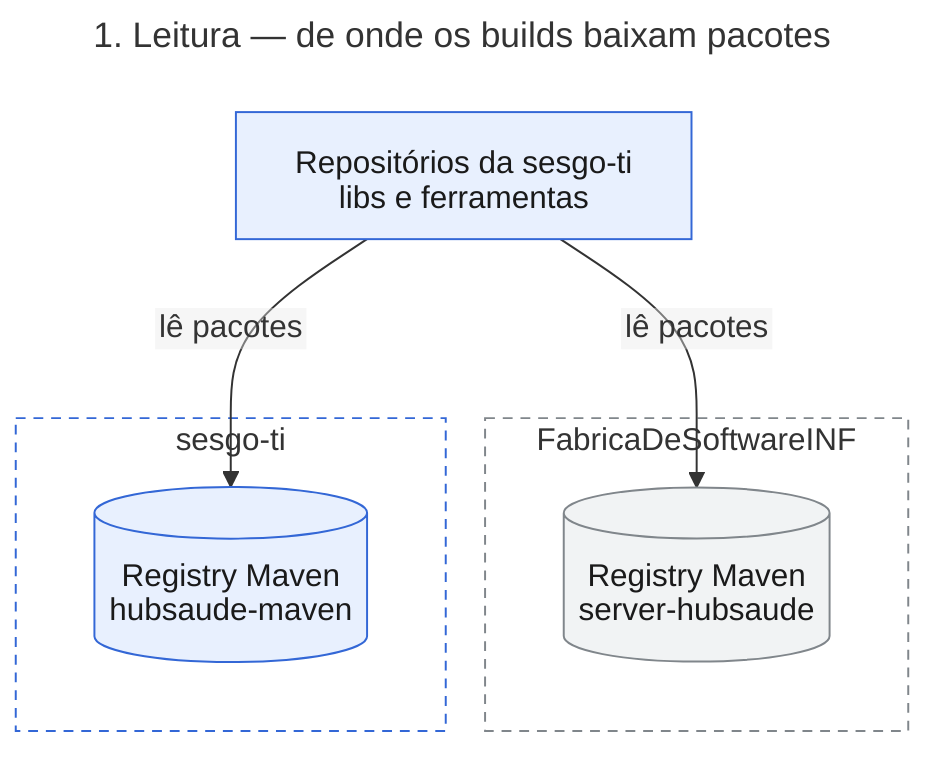
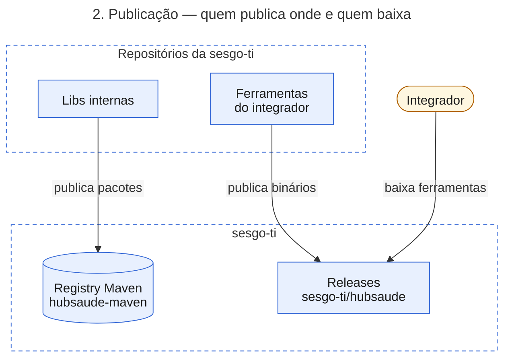

# sesgo-ti/.github

Workflows e actions reutilizáveis da sesgo-ti. Todo pipeline Maven da organização usa estes arquivos.
Para mudar um registry ou a versão do Java ou do Maven, altere só aqui.

## Como funciona





Leia cada seta como uma frase: origem → verbo → destino (ex.: "Libs internas publica pacotes no Registry Maven hubsaude-maven"). Azul: sesgo-ti. Cinza: fora da sesgo-ti. Amarelo: pessoa.

| Ação | Segredo do repositório |
|---|---|
| lê de um registry | `HUBSAUDE_MAVEN_READ_TOKEN` |
| publica no registry da sesgo-ti | `HUBSAUDE_MAVEN_WRITE_TOKEN` |
| publica em `sesgo-ti/hubsaude` | `HUBSAUDE_DIST_TOKEN` |
| baixa de `sesgo-ti/hubsaude` | nenhum (público) |

- Os pacotes do monorepo de origem são lidos de lá, sem cópia.
- O que a sesgo-ti produz vai para o registry da sesgo-ti.
- O integrador baixa as ferramentas pelas Releases de `sesgo-ti/hubsaude`.

## Criar um projeto novo

| Vou criar | Publica em | Segredos do repositório |
|---|---|---|
| Lib Java interna | registry da sesgo-ti | `HUBSAUDE_MAVEN_READ_TOKEN`, `HUBSAUDE_MAVEN_WRITE_TOKEN` |
| Ferramenta para o integrador | Release `hubsaude-<nome>-vX.Y.Z` em `sesgo-ti/hubsaude` | `HUBSAUDE_MAVEN_READ_TOKEN`, `HUBSAUDE_DIST_TOKEN` |
| SDK público | Maven Central, npm, PyPI ou NuGet | credenciais do registry público |
| Serviço | `ghcr.io/sesgo-ti/<nome>` | nenhum (usa o `GITHUB_TOKEN`) |

1. Peça à equipe de operação os segredos do repositório.
2. Use no CI:

   ```yaml
   jobs:
     build:
       uses: sesgo-ti/.github/.github/workflows/maven-ci.yml@<sha> # v1.0.0
       with:
         maven-args: -B -ntp verify
       secrets:
         maven-read-token: ${{ secrets.HUBSAUDE_MAVEN_READ_TOKEN }}
   ```

3. Se for uma lib, declare no `pom.xml`:

   ```xml
   <distributionManagement>
       <repository>
           <id>github-sesgo-ti</id>
           <url>https://maven.pkg.github.com/sesgo-ti/hubsaude-maven</url>
       </repository>
   </distributionManagement>
   ```

   Não publique uma coordenada que o registry de origem já publica.
4. Se for uma ferramenta, chame `distribuir-ferramenta.yml` na release. O exemplo está no topo do arquivo.

## Referência

### Workflows e action

| Arquivo | Função | Recebe |
|---|---|---|
| `.github/actions/setup-maven` | Instala o Java e o Maven pinados e gera o `settings.xml` com os dois registries. | env `MAVEN_ACTOR`, `MAVEN_TOKEN` |
| `.github/workflows/maven-ci.yml` | CI Maven. | segredo `maven-read-token` |
| `.github/workflows/distribuir-ferramenta.yml` | Publica a ferramenta em `sesgo-ti/hubsaude`. Nunca sobrescreve; se os bytes forem iguais, não faz nada. | segredo `dist-token` |

### Segredos

Os segredos ficam no repositório que chama o workflow e são fornecidos pela equipe de operação. Se o repositório usa Dependabot e depende de pacote privado, o `HUBSAUDE_MAVEN_READ_TOKEN` também precisa estar no escopo Dependabot.

### Versões

Aponte sempre para o SHA de uma versão, com a tag em comentário (`@<sha> # v1.0.0`). O Dependabot propõe as atualizações.

## Desenvolver aqui

```bash
for t in tests/*.test.sh; do bash "$t"; done
shellcheck -x tests/*.sh .github/actions/setup-maven/*.sh
actionlint
```
